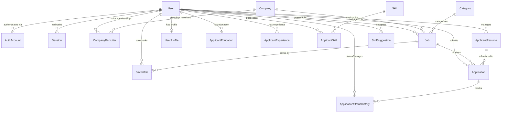

# Job Portal — Comprehensive Database Documentation

## 1. Overview & Database Architecture
- **DBMS**: MariaDB / MySQL (Compatible with MySQL 8.0+ and MariaDB 10.5+)
- **ORM**: Prisma ORM 7 (`@prisma/client` & `@prisma/adapter-mariadb`)
- **Schema Location**: `prisma/schema.prisma`
- **Generated Client Path**: `src/generated/prisma`
- **Total Entities**: 18 Models, 13 Enums

---

## 2. Entity-Relationship Diagram

---

## 3. Enumerations Specification

| Enum Name | Allowed Values | Usage / Context |
| :--- | :--- | :--- |
| `UserRole` | `APPLICANT`, `RECRUITER`, `ADMIN` | System-wide authorization level on `User`. |
| `AuthProvider` | `EMAIL_OTP`, `GOOGLE` | Identity provider on `AuthAccount`. |
| `OtpPurpose` | `REGISTER`, `LOGIN` | Target operation for one-time code verification. |
| `CompanyMembershipRole` | `OWNER`, `ADMIN`, `RECRUITER` | Hierarchy within a corporate employer team. |
| `CompanyMembershipStatus` | `PENDING`, `ACTIVE`, `REJECTED`, `REMOVED` | Member access status for company recruiters. |
| `CompanyVerificationStatus` | `UNVERIFIED`, `PENDING`, `VERIFIED`, `REJECTED` | Platform trust verification status for companies. |
| `JobStatus` | `DRAFT`, `PENDING_REVIEW`, `PUBLISHED`, `REJECTED`, `EXPIRED`, `CLOSED` | Publishing and moderation lifecycle of a job post. |
| `EmploymentType` | `FULL_TIME`, `PART_TIME`, `CONTRACT`, `INTERNSHIP` | Work arrangement classification. |
| `ExperienceLevel` | `FRESHER`, `EXPERIENCED` | Candidate experience requirement category. |
| `SalaryPeriod` | `MONTHLY`, `YEARLY`, `HOURLY`, `NOT_DISCLOSED` | Frequency of compensation remuneration. |
| `ApplicationMethod` | `INTERNAL`, `EXTERNAL`, `EMAIL` | How job seekers must submit their application. |
| `ApplicationStatus` | `SUBMITTED`, `UNDER_REVIEW`, `SHORTLISTED`, `REJECTED`, `HIRED`, `WITHDRAWN` | Hiring pipeline progress for candidate applications. |
| `SkillSuggestionStatus` | `PENDING`, `APPROVED`, `REJECTED` | Review state for user-submitted skill taxonomy. |

---

## 4. Models Specification

### 4.1 `User`
Primary entity representing all platform actors.
- **Fields**:
  - `id` (`String` @id @default(cuid()))
  - `name` (`String?` @db.VarChar(150))
  - `email` (`String` @unique @db.VarChar(254))
  - `role` (`UserRole` @default(APPLICANT))
  - `isActive` (`Boolean` @default(true))
  - `emailVerifiedAt` (`DateTime?`)
  - `createdAt` (`DateTime` @default(now()))
  - `updatedAt` (`DateTime` @updatedAt)
- **Indexes**: `@@index([role, isActive])`
- **Relations**: Cascade deletes to personal child records (`UserProfile`, `ApplicantEducation`, `ApplicantExperience`, `ApplicantSkill`, `ApplicantResume`, `SavedJob`, `Session`, `AuthAccount`).

### 4.2 `AuthAccount`
Federated identity linking (Email OTP and Google OpenID).
- **Fields**:
  - `id` (`String` @id @default(cuid()))
  - `userId` (`String`)
  - `provider` (`AuthProvider`)
  - `providerAccountId` (`String` @db.VarChar(255))
  - `createdAt` (`DateTime` @default(now()))
- **Constraints**:
  - `@@unique([provider, providerAccountId])`
  - `@@unique([userId, provider])`
  - `@@index([userId])`

### 4.3 `EmailOtp`
Stores temporary verification hashes for multi-factor/passwordless login and registration.
- **Fields**:
  - `id` (`String` @id @default(cuid()))
  - `email` (`String` @db.VarChar(254))
  - `otpHash` (`String` @db.VarChar(255))
  - `purpose` (`OtpPurpose`)
  - `expiresAt` (`DateTime`)
  - `attempts` (`Int` @default(0))
  - `consumedAt` (`DateTime?`)
  - `createdAt` (`DateTime` @default(now()))
- **Indexes**: `@@index([email, purpose, expiresAt])`

### 4.4 `Session`
Opaque authenticated user sessions.
- **Fields**:
  - `id` (`String` @id @default(cuid()))
  - `userId` (`String`)
  - `tokenHash` (`String` @unique @db.VarChar(255))
  - `expiresAt` (`DateTime`)
  - `revokedAt` (`DateTime?`)
  - `createdAt` (`DateTime` @default(now()))
- **Indexes**: `@@index([userId, expiresAt])`

### 4.5 `OtpRateLimit`
Sliding-window rate limiting and concurrency row locking.
- **Fields**:
  - `id` (`String` @id @default(cuid()))
  - `key` (`String` @unique @db.VarChar(255))
  - `hits` (`Int` @default(0))
  - `windowStart` (`DateTime`)
  - `updatedAt` (`DateTime` @updatedAt)
- **Indexes**: `@@index([windowStart])`

### 4.6 `Category`
Job industry categorization.
- **Fields**:
  - `id` (`String` @id @default(cuid()))
  - `name` (`String` @unique @db.VarChar(100))
  - `slug` (`String` @unique @db.VarChar(120))
  - `description` (`String?` @db.VarChar(300))
  - `isActive` (`Boolean` @default(true))
  - `sortOrder` (`Int` @default(0))
  - `createdAt` (`DateTime` @default(now()))
  - `updatedAt` (`DateTime` @updatedAt)
- **Indexes**: `@@index([isActive, sortOrder])`

### 4.7 `Company`
Employer organizations.
- **Fields**:
  - `id` (`String` @id @default(cuid()))
  - `name` (`String` @db.VarChar(150))
  - `slug` (`String` @unique @db.VarChar(180))
  - `overview` (`String?` @db.VarChar(300))
  - `industry` (`String?` @db.VarChar(100))
  - `logo` (`String?` @db.VarChar(500))
  - `website` (`String?` @db.VarChar(500))
  - `officialEmail` (`String?` @db.VarChar(254))
  - `location` (`String?` @db.VarChar(150))
  - `verification` (`CompanyVerificationStatus` @default(UNVERIFIED))
  - `rating` (`Decimal?` @db.Decimal(2, 1))
  - `createdAt` (`DateTime` @default(now()))
  - `updatedAt` (`DateTime` @updatedAt)
- **Indexes**: `@@index([name])`, `@@index([verification])`

### 4.8 `CompanyRecruiter`
Junction entity establishing multi-tenant company memberships and permissions.
- **Fields**:
  - `id` (`String` @id @default(cuid()))
  - `userId` (`String`)
  - `companyId` (`String`)
  - `membershipRole` (`CompanyMembershipRole` @default(RECRUITER))
  - `status` (`CompanyMembershipStatus` @default(PENDING))
  - `createdAt` (`DateTime` @default(now()))
  - `updatedAt` (`DateTime` @updatedAt)
- **Constraints**:
  - `@@unique([userId, companyId])`
  - `@@index([companyId, status])`
  - `@@index([userId, status])`

### 4.9 `Job`
Job vacancy postings.
- **Fields**:
  - `id` (`String` @id @default(cuid()))
  - `slug` (`String` @unique @db.VarChar(180))
  - `title` (`String` @db.VarChar(37))
  - `shortDescription` (`String` @db.VarChar(500))
  - `role` (`String` @db.VarChar(20))
  - `detailedTitle` (`String` @db.VarChar(250))
  - `description` (`String` @db.Text)
  - `location` (`String` @db.VarChar(150))
  - `employmentType` (`EmploymentType`)
  - `experienceLevel` (`ExperienceLevel`)
  - `experienceYears` (`Decimal?` @db.Decimal(4, 1))
  - `salaryMin` (`Decimal?` @db.Decimal(10, 2))
  - `salaryMax` (`Decimal?` @db.Decimal(10, 2))
  - `salaryCurrency` (`String` @default("INR") @db.VarChar(3))
  - `salaryPeriod` (`SalaryPeriod` @default(NOT_DISCLOSED))
  - `qualifications`, `skills`, `experienceDetails`, `otherData`, `keywords` (`Json?`)
  - `logo` (`String?` @db.VarChar(500))
  - `rating` (`Decimal?` @db.Decimal(2, 1))
  - `metaTitle` (`String?` @db.VarChar(60)), `metaDescription` (`String?` @db.VarChar(160)), `canonicalUrl` (`String?` @db.VarChar(500))
  - `ogTitle`, `ogDescription`, `ogImage`, `ogImageAlt`, `ogType`
  - `status` (`JobStatus` @default(DRAFT))
  - `applicationMethod` (`ApplicationMethod` @default(EXTERNAL))
  - `applicationUrl`, `applicationEmail`, `allowGuestApply`
  - `applicationCount` (`Int` @default(0)), `applyClickCount` (`Int` @default(0))
  - `publishedAt`, `deadline`, `closedAt` (`DateTime?`)
  - `companyId`, `categoryId`, `postedById`
- **Indexes**:
  - `@@index([status, publishedAt])`
  - `@@index([location])`
  - `@@index([employmentType])`
  - `@@index([categoryId])`
  - `@@index([experienceLevel, experienceYears])`
  - `@@index([companyId])`
  - `@@index([deadline])`
  - `@@index([postedById])`

### 4.10 `Application`
Candidate applications for job posts.
- **Fields**:
  - `id` (`String` @id @default(cuid()))
  - `jobId` (`String`)
  - `userId` (`String`)
  - `applicantName` (`String` @db.VarChar(150))
  - `applicantEmail` (`String` @db.VarChar(254))
  - `resumeUrl` (`String` @db.VarChar(1000))
  - `resumeId` (`String?`, foreign key to `ApplicantResume`, `onDelete: SetNull`)
  - `resumeStorageKey` (`String?` @db.VarChar(500), points to preserved immutable copy in `private/application-resumes/`)
  - `resumeFileName` (`String?` @db.VarChar(255))
  - `resumeMimeType` (`String?` @db.VarChar(100))
  - `resumeFileSize` (`Int?`)
  - `coverLetter` (`String?` @db.Text)
  - `profileSnapshot` (`Json?`, captures applicant info, headline, bio, education, experience, and skills at application time)
  - `status` (`ApplicationStatus` @default(SUBMITTED))
  - `createdAt` (`DateTime` @default(now()))
  - `updatedAt` (`DateTime` @updatedAt)
- **Constraints**:
  - `@@unique([jobId, userId])` (Enforces strict duplicate application prevention)
  - `@@index([jobId, status, createdAt])`
  - `@@index([userId, createdAt])`
  - `@@index([resumeId])`

### 4.10b `ApplicationStatusHistory`
Audit log of every hiring pipeline status transition for an application.
- **Fields**:
  - `id` (`String` @id @default(cuid()))
  - `applicationId` (`String`, foreign key to `Application`, `onDelete: Cascade`)
  - `previousStatus` (`ApplicationStatus?`)
  - `newStatus` (`ApplicationStatus`)
  - `changedById` (`String?`, foreign key to `User`, `onDelete: SetNull`)
  - `reason` (`String?` @db.VarChar(500))
  - `createdAt` (`DateTime` @default(now()))
- **Constraints**:
  - `@@index([applicationId, createdAt])`
  - `@@index([changedById])`

### 4.11 `UserProfile`
Extended profile for candidate presentation.
- **Fields**:
  - `id` (`String` @id @default(cuid()))
  - `userId` (`String` @unique)
  - `phone` (`String?` @db.VarChar(20))
  - `headline` (`String?` @db.VarChar(200))
  - `bio` (`String?` @db.Text)
  - `location` (`String?` @db.VarChar(150))
  - `profileImage` (`String?` @db.VarChar(500))
  - `socials` (`Json?`)
  - `createdAt`, `updatedAt`

### 4.12 `ApplicantEducation`
Academic qualifications history.
- **Fields**: `id`, `userId`, `institution`, `degree`, `fieldOfStudy`, `startDate`, `endDate`, `isCurrentlyStudying`, `grade`, `description`, `createdAt`, `updatedAt`
- **Indexes**: `@@index([userId, startDate])`

### 4.13 `ApplicantExperience`
Employment and professional experience history.
- **Fields**: `id`, `userId`, `companyName`, `jobTitle`, `employmentType`, `location`, `description`, `startDate`, `endDate`, `isCurrent`, `createdAt`, `updatedAt`
- **Indexes**: `@@index([userId, startDate])`

### 4.14 `Skill` & `ApplicantSkill`
Platform skills taxonomy and many-to-many candidate skill mappings.
- **Skill**: `id`, `name` (@unique), `slug` (@unique), timestamps.
- **ApplicantSkill**: Composite PK `@@id([userId, skillId])`, `@@index([skillId])`.

### 4.15 `ApplicantResume`
Applicant private resume files stored on private storage.
- **Fields**: `id`, `userId`, `title`, `fileName`, `storageKey`, `mimeType`, `fileSize`, `isDefault`, timestamps.
- **Indexes**: `@@index([userId, isDefault])`

### 4.16 `SavedJob`
Applicant bookmarked jobs.
- **Fields**: `id`, `userId`, `jobId`, `createdAt`.
- **Constraints**: `@@unique([userId, jobId])`, `@@index([userId, createdAt])`, `@@index([jobId])`.

### 4.17 `SkillSuggestion`
Candidate suggestions for expanding the skill taxonomy.
- **Fields**: `id`, `name` (@unique), `normalized` (@unique), `suggestedBy`, `status` (@default(PENDING)), timestamps.
- **Indexes**: `@@index([status])`
