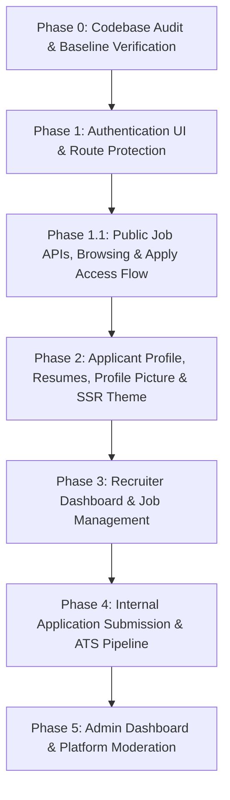

# Job Portal — Complete Implementation Roadmap

This roadmap defines the prioritized, dependency-ordered engineering sequence for transforming the project into a complete, production-ready Job Portal.

---

## Roadmap Overview & Dependency Flow

---

## Phase 0: Complete Codebase Audit & Documentation
- **Status**: **COMPLETE**
- **Objectives**: Inspect local codebase, verify runtime build & lint checks, document database models, endpoints, security defects, and establish baseline documentation.
- **Deliverables**: Comprehensive audit files in `docs/` (`PROJECT_OVERVIEW.md`, `FEATURE_MATRIX.md`, `API_DOCUMENTATION.md`, `DATABASE_DOCUMENTATION.md`, `SECURITY_AUDIT.md`, `PRODUCT_REQUIREMENTS.md`, `TECHNICAL_DEBT.md`, `IMPLEMENTATION_ROADMAP.md`).

---

## Phase 1: Authentication UI & Route Protection
- **Status**: **COMPLETE** (Subject to final verification)
- **Priority**: **Critical**
- **Objectives**: Implement complete responsive authentication experience with role-based routing and edge protection.
- **Features**:
  1. `/login` page with Email OTP and Google Sign-In button.
  2. `/register` page with role selection (`APPLICANT` or `RECRUITER`) and OTP verification.
  3. Edge proxy (`src/proxy.ts`) using Next.js 16 conventions protecting `/dashboard/*`, `/recruiter/*`, `/admin/*` without blocking public routes.
  4. Authoritative session validation in server-side layouts (`getServerSession`) and API routes.
  5. Role-based redirect enforcement (`APPLICANT` -> `/dashboard`, `RECRUITER` -> `/recruiter/dashboard`, `ADMIN` -> `/admin`).
  6. Logout button and session revocation.
- **Files Affected**:
  - `src/proxy.ts`
  - `src/app/(auth)/login/page.tsx` & `login-form.tsx`
  - `src/app/(auth)/register/page.tsx` & `register-form.tsx`
  - `src/lib/auth/session.ts`
  - `src/lib/auth/redirects.ts`
  - `src/app/api/auth/*`
- **Verification**: All TypeScript checks, linter checks, and Next.js production builds compile cleanly.

---

## Phase 1.1: Public Job APIs, Public Job Browsing & Apply Access Flow
- **Status**: **COMPLETE**
- **Priority**: **Critical**
- **Objectives**: Deliver a public, unauthenticated job search, browsing, and discovery experience with seamless handling of both internal and external job application paths.
- **Completed Deliverables**:
  1. **Public Unauthenticated Access**:
     - Visitors can freely browse the homepage (`/`), search jobs (`/jobs`), apply multi-faceted filters, open job details (`/jobs/[slug]`), view company directory & profiles (`/companies`, `/companies/[slug]`), and explore categories (`/categories`, `/categories/[slug]`) without logging in.
  2. **API Fixes & Additions**:
     - Updated `GET /api/jobs`: Included `applicationMethod` in select projection.
     - Implemented `POST /api/jobs/[slug]/click`: Sliding-window rate-limited (30 req/min/IP), deadline check, atomic increment of `applyClickCount`, destination URL validation.
  3. **Shared Public Components**:
     - `src/components/public/public-nav.tsx`: Responsive navigation header with active auth detection.
     - `src/components/public/public-footer.tsx`: Comprehensive footer with directory and category links.
     - `src/components/auth/auth-modal.tsx`: Accessible dialog supporting Email OTP and Google OAuth with safe redirect preservation.
     - `src/components/public/job-apply-button.tsx`: Handles external redirect + click tracking, mailto links, and guest auth modal triggering.
  4. **Public Pages**:
     - `src/app/page.tsx`: SSR homepage with live stats, hero search form, latest published jobs, top categories, and verified companies.
     - `src/app/jobs/page.tsx`: SSR search and filter page with URL sync, pagination, and empty states.
     - `src/app/jobs/[slug]/page.tsx`: Job details page with dynamic metadata, Google Jobs JSON-LD schema, and `JobApplyButton`.
     - `src/app/companies/page.tsx` & `src/app/companies/[slug]/page.tsx`: Searchable company directory and verified company profiles.
     - `src/app/categories/page.tsx` & `src/app/categories/[slug]/page.tsx`: Category directory and specialized category job feeds.
  5. **Verification**:
     - All routes compile cleanly in `next build` (Next.js 16.4.5 Turbopack).
     - Full ESLint and TypeScript validation (0 errors, 0 warnings).
     - Verified click tracking, rate limiting, and unauthenticated SSR page delivery via automated test suite.
  3. **Homepage (`/`)**:
     - Dynamic hero search bar, category carousel, featured job listings, top hiring companies, platform stats.
  4. **Job Search & Listing (`/jobs`)**:
     - URL-synced multi-term search (`q`), filters for `skill`, `company`, `category`, `location`, `type` (`FULL_TIME`, `PART_TIME`, `CONTRACT`, `INTERNSHIP`).
     - Pagination controls, responsive layout with mobile filter drawer, empty states.
  5. **Job Details Page (`/jobs/[slug]`)**:
     - Comprehensive job specification: role title, rich description, responsibilities, required skills pills, salary display, deadline countdown, company information card.
     - Dynamic SEO metadata generation (`generateMetadata`) and Google Jobs JSON-LD structured data.
  6. **Apply Access Flow**:
     - **External Jobs (`applicationMethod === "EXTERNAL"`)**: Clicking Apply triggers `POST /api/jobs/[slug]/click` (incrementing `applyClickCount`) and redirects directly to employer's `applicationUrl` with no authentication required.
     - **Internal Jobs (`applicationMethod === "INTERNAL"`)**: Clicking Apply checks candidate session; if guest, displays login/register modal preserving destination; once authenticated, displays internal application modal.
  7. **Company & Category Discovery**:
     - Company directory (`/companies`) and company detail page (`/companies/[slug]`).
     - Category directory (`/categories`) and category detail page (`/categories/[slug]`).
- **Files Affected**:
  - `src/app/page.tsx` (Homepage)
  - `src/app/jobs/page.tsx` (New)
  - `src/app/jobs/[slug]/page.tsx` (New)
  - `src/app/companies/page.tsx` (New)
  - `src/app/companies/[slug]/page.tsx` (New)
  - `src/app/categories/page.tsx` (New)
  - `src/app/categories/[slug]/page.tsx` (New)
  - `src/app/api/jobs/route.ts` (Modified: add `applicationMethod` to select)
  - `src/app/api/jobs/[slug]/click/route.ts` (New: external apply click counter)
  - `src/components/public/*` (New)
- **Acceptance Criteria**:
  - Unauthenticated guests can search, filter, and view full job details.
  - External jobs redirect directly to external URL and increment `applyClickCount`.
  - Internal jobs prompt guests with an authentication modal before proceeding.

---

## Phase 2: Applicant Profile, Resume Management, Profile Picture & SSR Theme
- **Status**: **COMPLETE**
- **Priority**: **High**
- **Objectives**: Deliver the complete career profile workspace for applicants, incorporating SSR theme switching, numeric phone validation, local profile picture cropping, private file storage, resume hub, and live completeness tracking.
- **Completed Deliverables**:
  1. **SSR Theme System**:
     - System / Light / Dark modes persisted via `theme` cookie (1-year lifetime, SameSite=Lax).
     - Inline anti-FOUC script in `<head>` ensures zero theme flash before page paint.
     - Live OS preference synchronization via `window.matchMedia("(prefers-color-scheme: dark)")`.
     - Tailwind CSS v4 class-based variant (`@custom-variant dark (&:where(.dark, .dark *));`).
     - Accessible `ThemeToggle` component in both public navigation and candidate dashboard.
  2. **Profile Picture Management & 1:1 Cropper**:
     - Interactive square crop editor (`src/components/profile/profile-picture-cropper.tsx`): 1:1 aspect ratio constraint, pointer/touch drag repositioning with boundary clamping, zoom slider (+ / - buttons), live circle/square preview, high-DPI offscreen canvas export.
     - Magic-byte validation (`src/lib/profile-picture-storage.ts`): supports JPEG, PNG, and WebP; strictly rejects SVG and non-image files.
     - Private file storage: files kept in `private/profile-pictures/` outside public web root with UUID filenames.
     - Safe replacement algorithm: validates new image, stores to unique key, updates database reference; if database update fails, immediately rolls back orphaned file; deletes previous file only after database confirmation.
     - Authenticated image streaming: `GET /api/me/profile/avatar` streams the authenticated applicant's own avatar with strict cache-control and security headers.
     - Upload endpoint: `POST /api/me/profile/avatar` handling multipart upload up to 5MB.
     - Deletion endpoint: `DELETE /api/me/profile/avatar` for clean removal.
     - Avatar display in dashboard overview banner, profile form, navigation header, and mobile bar.
  3. **Strict Numeric Phone Validation**:
     - Frontend: `type="tel"`, `inputMode="numeric"`, `pattern="[0-9]*"`, automatic stripping of non-digit inputs in `profile-form.tsx`.
     - Backend: Strict regex validation `/^\d{7,15}$/` in `src/app/api/me/profile/route.ts` rejecting letters, spaces, and symbols while preserving leading zeroes as string in database.
  4. **Documented Profile Completion Formula**:
     - Exact weights summing to 100%:
       - Phone & Location: 15%
       - Professional Headline & Bio: 15%
       - Profile Picture: 10%
       - Education History (>= 1): 20%
       - Work Experience (>= 1): 20%
       - Core Skills (>= 1): 10%
       - Primary Resume (>= 1): 10%
     - Actionable missing section links with hints.
  5. **Applicant Dashboard & Profile Hub**:
     - `/dashboard`: Real-time welcome greeting with avatar, completeness progress bar, missing checklist, default resume status card, recent experience, education, and skills widgets.
     - `/dashboard/profile`: Personal details, numeric phone, headline, bio, location, social channels, and interactive profile picture cropper.
     - `/dashboard/profile/education`: Full CRUD with date validation and currently studying toggle.
     - `/dashboard/profile/experience`: Full CRUD with employment types and current position toggle.
     - `/dashboard/profile/skills`: Autocomplete skills lookup, instant addition, chip removal, skill suggestion workflow.
     - `/dashboard/resumes`: Private resume uploads, magic-byte check, default selection, authenticated streaming download, two-phase delete.
  6. **Verification**:
     - Zero TypeScript errors (`npx tsc --noEmit`).
     - Zero ESLint warnings or errors (`npm run lint`).
     - Next.js 16.4.5 Turbopack production build succeeded (`npm run build`).
     - Comprehensive automated test suite verified theme cookie rendering, phone regex rejection, SVG rejection, magic-byte inspection, safe avatar replacement, and SSR page loads.
- **Core Requirements**:
  1. **SSR Theme System**:
     - System, Light, and Dark modes (System mode default).
     - SSR-compatible initial theme using a secure `theme` cookie to avoid FOUC and hydration mismatches.
     - Real-time client sync with operating system preference changes when in System mode.
     - Applied globally across all public, applicant, recruiter, and admin views.
  2. **Candidate Numeric Phone Field**:
     - Strictly numeric characters only (`0–9`).
     - Telephone input with `inputMode="numeric"`.
     - Reject alphabetic characters and unsupported symbols on both frontend and backend.
     - Stored as a string in `UserProfile.phone` to preserve leading zeroes.
  3. **Profile Picture Upload & Cropping**:
     - Local device image upload with mandatory 1:1 square crop.
     - Interactive modal for repositioning and zooming non-square images.
     - Client-side crop preview before saving.
     - Backend storage in `private/profile-pictures/`.
     - Maximum file size: 5 MB (configurable).
     - Formats: JPEG, PNG, WebP only; verified via raw binary magic-byte signatures. Explicitly reject SVG, GIF, HTML, and executables.
     - Unique server-generated UUID filenames.
     - Authenticated image streaming endpoint (e.g. `GET /api/me/profile/avatar`).
     - Safe two-phase atomic replacement: old image is never deleted until the new image is committed to disk and database.
     - Display avatar in dashboard overview, profile form, and navigation header.
  4. **Applicant Profile Management (`/dashboard/profile`)**:
     - Full name, numeric phone, headline, bio, location, avatar, and validated social links.
  5. **Education & Experience Timeline (`/dashboard/profile/education`, `/dashboard/profile/experience`)**:
     - Add/Edit/Delete modals, date range validations, "Currently Studying" and "Currently Working" toggles, delete confirmation dialogs.
  6. **Skills & Suggestions (`/dashboard/profile/skills`)**:
     - Autocomplete search from canonical skills taxonomy (`/api/skills?q=...`), chip deletion, duplicate prevention, custom skill suggestion dialog with status tracking.
  7. **Resume Hub (`/dashboard/resumes`)**:
     - Drag-and-drop file upload (PDF/DOC/DOCX up to 5MB, magic-byte validated), default resume toggle, authenticated streaming download, two-phase atomic file deletion.
  8. **Real-Time Profile Completeness**:
     - 5-pillar transparent calculation (0–100%) with checklist linking to missing sections.
- **Files Affected**:
  - `src/app/layout.tsx` & `src/app/globals.css` (SSR Theme support)
  - `src/lib/theme/*` (New)
  - `src/lib/profile-picture-storage.ts` (New)
  - `src/app/api/me/profile/avatar/route.ts` (New: upload & stream avatar)
  - `src/app/api/me/profile/route.ts` (Modified: numeric phone validation)
  - `src/app/dashboard/*`
- **Acceptance Criteria**:
  - Changing theme switches instantly and persists across reloads with zero FOUC.
  - Uploading a non-square photo crops to 1:1 square and saves to `private/profile-pictures/`.
  - Non-numeric characters in phone number are rejected on frontend and backend.
  - Profile completion meter updates dynamically based on saved database records.

---

## Phase 3: Recruiter Dashboard & Job Management
- **Status**: **COMPLETE**
- **Priority**: **High**
- **Objectives**: Enable employers to create companies, invite teammates, and publish/manage jobs with strict role boundaries, cross-company isolation, and seamless public integration.
- **Completed Deliverables**:
  1. **Recruiter Authorization & Multi-Tenant Isolation**:
     - `src/lib/auth/recruiter.ts`: `getRecruiterSession()` server helper and `requireRecruiterApi()` API guard enforcing `UserRole === 'RECRUITER' | 'ADMIN'` and `status === 'ACTIVE'` membership.
     - Cross-role boundaries: applicants attempting to access recruiter views are redirected to `/dashboard`; unauthenticated visitors are redirected to `/login?redirect=...`.
     - Cross-company isolation: recruiters from one organization are strictly blocked (403) from accessing, modifying, or deleting another organization's company profile, jobs, or team members.
  2. **Recruiter Onboarding Flow**:
     - Route: `/recruiter/onboarding` (`src/app/recruiter/onboarding/page.tsx` & `onboarding-form.tsx`).
     - Detects recruiters with no active company membership and renders an intuitive setup flow.
     - `POST /api/recruiter/company`: Validates fields, generates unique slug, creates `Company` (UNVERIFIED) and assigns creator as `OWNER` atomically in a database transaction.
  3. **Company Management & Logo Storage**:
     - Route: `/recruiter/company` (`src/app/recruiter/company/page.tsx` & `company-form.tsx`).
     - Edits company details: legal name, industry, location, website URL, official contact email, overview (with strict VarChar 300 constraint enforcement).
     - Verification status banner with visual indicator badges: UNVERIFIED, PENDING, VERIFIED, REJECTED.
     - Role permissions: only Owner or Admin can update corporate details or upload branding; standard Recruiters view read-only fields with guidance notice.
     - `src/lib/company-logo-storage.ts`: Private disk storage in `private/company-logos/` outside public web root with UUID keys.
     - `POST /api/recruiter/company/logo`: Multipart upload capped at 5MB, validates magic bytes (JPEG, PNG, WebP; strictly rejects SVG), rolls back orphaned files on DB failure.
     - `GET /api/companies/[slug]/logo`: Public authenticated streaming route with ETag caching, cache headers, and `304 Not Modified` support.
     - Direct link to public company overview page (`/companies/[slug]`).
  4. **Job Posting Wizard**:
     - Route: `/recruiter/jobs/new` (`src/app/recruiter/jobs/new/page.tsx` & `job-wizard.tsx`).
     - 5-step guided wizard with visual progress bar and step validation:
       - Step 1: Basic Information (Title <= 37 chars, Detailed Title <= 250 chars, Role Tag <= 20 chars, Category selector, Employment Type, Location, Experience Level & Years).
       - Step 2: Description & Skills (Short summary <= 500 chars, full markdown description, qualifications, interactive skills tag chip input).
       - Step 3: Compensation (Min/Max numeric validation, currency selector, pay frequency period).
       - Step 4: Application Pipeline (INTERNAL with allowGuestApply modal toggle, EXTERNAL with URL validation, EMAIL with email validation, deadline date picker).
       - Step 5: Review & Publish (Comprehensive card and spec preview, "Save as Draft", "Publish Immediately").
     - `POST /api/recruiter/jobs`: Full server-side validation, slug generation, atomic creation, and automatic route cache revalidation (`/`, `/jobs`, `/companies/[slug]`, `/categories/[slug]`).
  5. **Job Management Dashboard**:
     - Route: `/recruiter/jobs` (`src/app/recruiter/jobs/page.tsx` & `jobs-manager.tsx`).
     - Real-time status filter tabs (All, Published, Draft, Closed, Expired), keyword search bar, and server pagination.
     - Detailed data table: Title, Role, Category, Application Method, Status Badge, Application count & Apply click metrics, Created date, and quick action buttons.
     - Quick publish for drafts, quick close for published listings, and draft deletion with confirmation dialog modal.
  6. **Job Editing Experience**:
     - Route: `/recruiter/jobs/[id]/edit` (`src/app/recruiter/jobs/[id]/edit/page.tsx` & `job-edit-form.tsx`).
     - Pre-populated form loaded with existing job data and categories, ownership validation, status dropdown (Draft, Published, Closed), and live update feedback.
     - `PATCH /api/recruiter/jobs/[id]`: Partial updates, status lifecycle transitions, revalidates public feeds.
     - `DELETE /api/recruiter/jobs/[id]`: Strictly restricted to Draft jobs without submitted candidate applications.
  7. **Team Management**:
     - Route: `/recruiter/team` (`src/app/recruiter/team/page.tsx` & `team-manager.tsx`).
     - Team member table: Avatar initials, Name, Email, Membership Role (`OWNER`, `ADMIN`, `RECRUITER`), Status (`ACTIVE`), Joined date.
     - `POST /api/recruiter/team`: Adds registered user by email, assigns role (only Owner can appoint Admin), auto-promotes Applicant account to Recruiter.
     - `DELETE /api/recruiter/team/[recruiterId]`: Revokes membership; protects Owner from removal, prevents self-removal, and prevents Admin from removing other Admins.
     - Clear policy disclosure notice regarding registered user requirement vs future external email invitations.
  8. **Phase 2 Hardening Checks**:
     - DOCX ZIP structure validation: inspected `src/lib/resume-storage.ts`, confirmed End of Central Directory (EOCD) & Central Directory headers check for `[Content_Types].xml` and `word/document.xml`.
     - Avatar cache behavior: hardened `src/app/api/me/profile/avatar/route.ts` with explicit `ETag` and `Cache-Control: private, no-cache, must-revalidate` returning `304 Not Modified`.
  9. **Verification**:
     - Zero TypeScript errors (`npx tsc --noEmit`).
     - Zero ESLint warnings or errors (`npm run lint`).
     - Next.js 16.4.5 Turbopack production build succeeded (`npm run build`).
     - End-to-end automated test suite verified onboarding, multiple company prevention, SVG rejection, PNG logo streaming with ETag, job posting wizard, draft vs published public visibility, cross-company isolation (403), draft deletion, and team member lifecycle.

---

## Phase 4: Internal Application Submission & ATS Pipeline
- **Status**: **COMPLETE**
- **Priority**: **Critical**
- **Objectives**: Complete the internal application loop, immutable snapshot preservation, recruiter candidate ATS pipeline, and candidate application tracking.
- **Implemented Features**:
  1. Internal Application Submission:
     - `POST /api/jobs/[slug]/apply`: Strictly enforces `APPLICANT` role, validates job status/deadline/INTERNAL method, verifies user's resume ownership and physical existence, captures full immutable profile snapshot (contact, bio, headline, education, experience, skills), copies resume to `private/application-resumes/`, prevents duplicate submissions via `@@unique([jobId, userId])` constraint (409 Conflict), atomically increments `Job.applicationCount`, records initial `ApplicationStatusHistory`, and dispatches email notifications.
     - Interactive Candidate Apply Modal (`JobApplyModal`) on `/jobs/[slug]` with resume selector, default badge indicator, inline upload fallback, cover letter input, snapshot disclosure, and accessible keyboard/focus trapping.
  2. Recruiter ATS Pipeline (`/recruiter/jobs/[id]/applications`):
     - Complete ATS workspace with candidate table, status filter tabs (`All`, `Submitted`, `Under Review`, `Shortlisted`, `Rejected`, `Hired`, `Withdrawn`), search query input (`q`), and pagination.
     - Candidate Review Modal/Drawer with candidate contact details, submitted cover letter, application-time education/experience/skills snapshot, and full status timeline audit trail.
     - Authorized Recruiter Resume Streaming: `GET /api/recruiter/applications/[id]/resume` with multi-tenant company isolation and security headers.
     - Recruiter Pipeline Status Updates: `PATCH /api/recruiter/applications/[id]/status` validating allowed transitions, recording `ApplicationStatusHistory` audit entries with reasons, and triggering candidate notifications.
  3. Applicant Application Tracking (`/dashboard/applications`):
     - Server-rendered candidate dashboard with status filtering, search, pagination, and empty state with open jobs link.
     - Application cards with job title, company logo/verification badge, location, submitted date, and status badges.
     - Application Snapshot Modal inspecting submission-time profile data.
     - Authorized Candidate Resume Streaming: `GET /api/me/applications/[id]/resume`.
     - Application Withdrawal: `POST /api/me/applications/[id]/withdraw` with confirmation dialog and reason logging.
  4. Integration & Security Verification:
     - 14-point automated test suite covering guest protection, role boundaries, method restrictions, resume ownership, immutable snapshot replication across resume deletion, duplicate prevention, applicant withdrawal, recruiter ATS pipeline with company isolation, and public browsing regression. All passed with 100% success rate.

---

## Phase 5: Admin Dashboard & Platform Moderation
- **Status**: **PLANNED**
- **Priority**: **Medium**
- **Objectives**: Provide platform superusers with oversight, verification auditing, content moderation, and taxonomy management.
- **Core Requirements**:
  1. Admin analytics overview (`/admin`): Registered users by role, active companies, pending verifications, pending jobs.
  2. Company verification review queue (`/admin/companies`): Approve or reject business verification requests.
  3. Job post moderation queue (`/admin/jobs`): Review postings submitted by unverified employers.
  4. Skill suggestions queue (`/admin/skills`): Approve user-submitted skills (auto-promotes to `Skill` table) or reject.
  5. Category taxonomy editor (`/admin/categories`): Create, reorder, and toggle job categories.
  6. User moderation (`/admin/users`): Inspect profiles, manage active status (`isActive = false`).
