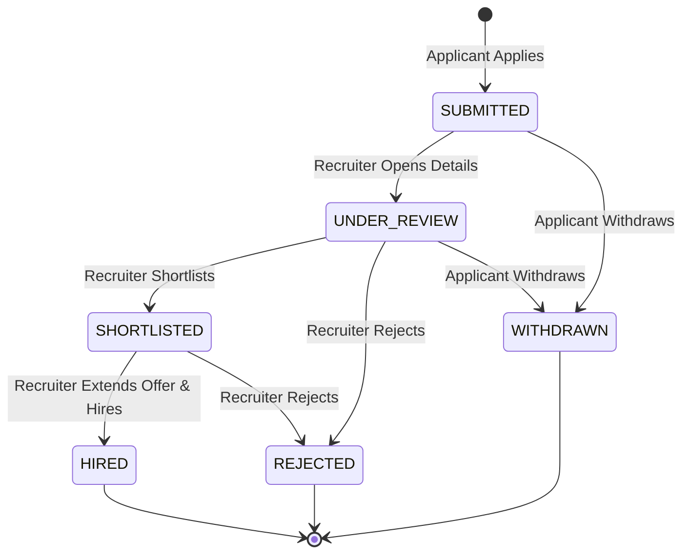

# Job Portal — Product Requirements & Business Rules

## 1. Domain Requirements Overview

The Job Portal is divided into four major functional domains:
1. **Public Website**: Candidate discovery, SEO pages, company branding.
2. **Applicant Dashboard**: Career identity, resume assets, application tracking.
3. **Recruiter Dashboard**: Employer organization setup, job lifecycle, talent pipeline.
4. **Admin Dashboard**: Moderation, taxonomy curation, platform trust & safety.

---

## 2. Core Business Rules & Decisions

### 2.1 Recruiter Onboarding & Company Association
- **Can anyone register as a recruiter?**
  Yes. Any visitor can register with `role: "RECRUITER"` using Email OTP.
- **How does a recruiter create or join a company?**
  - **Company Creation**: If the recruiter's company does not exist on the platform, the recruiter completes a "Company Creation Wizard". The creator is automatically assigned `CompanyMembershipRole.OWNER` with `CompanyMembershipStatus.ACTIVE`.
  - **Joining an Existing Company**: A recruiter can search for an existing company and submit a "Join Request" (status `PENDING`). Alternatively, an existing company OWNER or ADMIN can issue an invitation to the recruiter's email.
  - **Unassociated Recruiters**: Recruiters without an active company association cannot post jobs or access applicant details.

### 2.2 Company Ownership & Membership Permissions
- **OWNER**: Single or primary company head. Has full authority to edit company settings, request verification, approve/reject recruiter join requests, promote/demote members, and delete/transfer ownership.
- **ADMIN**: Can manage jobs, invite recruiters, review applications, and edit general company details. Cannot remove the OWNER.
- **RECRUITER**: Can post/edit jobs and review applicants for the company's postings. Cannot alter company profile or manage teammates.
- **Membership Statuses**:
  - `PENDING`: Awaiting approval from Company OWNER/ADMIN.
  - `ACTIVE`: Fully empowered member based on assigned role.
  - `REJECTED`: Join request declined.
  - `REMOVED`: Former member whose access was revoked.

### 2.3 Job Publishing & Moderation Lifecycle
- **Publishing Strategy**:
  - **Verified Companies**: Jobs posted by recruiters belonging to a company with `CompanyVerificationStatus.VERIFIED` transition automatically to `JobStatus.PUBLISHED` upon creation (or when published from draft).
  - **Unverified / First-Time Companies**: Jobs submitted by recruiters of `UNVERIFIED` or `PENDING` companies transition to `JobStatus.PENDING_REVIEW` and require platform administrator approval before going live to the public.
- **Status Transitions**:
  `DRAFT` -> `PENDING_REVIEW` -> `PUBLISHED` -> `CLOSED` / `EXPIRED`.
  Administrators can transition any job to `REJECTED`.

### 2.4 Public Job Browsing & Application Rules
- **Is authentication required for public browsing?**
  **NO.** Authentication must NEVER be mandatory for public job browsing. Visitors must be completely unhindered to:
  - Open the homepage (`/`).
  - Search, paginate, and filter jobs (`/jobs`).
  - Apply faceted filters (keyword, skill, location, employment type, category, company).
  - Open full job specifications (`/jobs/[slug]`).
  - Browse verified company directory and view public company profiles (`/companies`, `/companies/[slug]`).
  - Browse category taxonomy listings (`/categories`, `/categories/[slug]`).
- **Internal vs External Job Application Determination**:
  - The mode of application is determined **strictly from the database field `Job.applicationMethod`** (`INTERNAL`, `EXTERNAL`, `EMAIL`).
  - It must **never** be inferred from the structure of a URL, presence of query strings, or hardcoded client-side heuristics.
- **Internal Job Application Flow (`applicationMethod === "INTERNAL"`)**:
  1. A guest visitor clicks "Apply".
  2. The application opens a login/register modal/popup without losing candidate context or destination.
  3. Upon successful OTP verification or Google sign-in, the candidate continues directly into the internal application flow.
  4. The candidate selects a default/uploaded resume or uploads a new resume, adds an optional cover letter, and reviews credentials.
  5. The internal application is submitted via `POST /api/jobs/[slug]/apply`.
  6. `Job.applicationCount` is incremented **only after successful database insertion** of the `Application` record.
- **External Job Application Flow (`applicationMethod === "EXTERNAL"`)**:
  1. A visitor clicks "Apply".
  2. The portal **does not require authentication**.
  3. An API call triggers the external apply-click tracker (`applyClickCount` is incremented).
  4. The visitor is redirected directly to the employer's destination URL (`Job.applicationUrl`).
- **Email Job Application Flow (`applicationMethod === "EMAIL"`)**:
  - Directs candidate to send application via employer's specified email (`Job.applicationEmail`). Does not require portal authentication.
- **Duplicate Application Prevention**:
  - Enforced by database unique constraint `@@unique([jobId, userId])` for internal applications.
- **Application Withdrawal**:
  - Applicants may withdraw internal applications while in `SUBMITTED` or `UNDER_REVIEW` status. Moves status to `WITHDRAWN`.

### 2.5 Resume Access & Document Privacy
- **Who can access private resumes?**
  - The applicant who uploaded the resume can view, download, rename, and delete it.
  - An active recruiter belonging to the specific company that posted the job can view and download the applicant's resume attached to that specific job application.
  - Resumes are **never publicly accessible** via static asset URLs. All downloads pass through authenticated, permission-checked API routes with anti-sniffing headers and sandboxed content security policies.

### 2.6 SSR Theme System (Light, Dark, System)
- **Supported Modes**: `System`, `Light`, `Dark`.
- **Default Mode**: `System`.
- **SSR Compatibility**:
  - Initial HTML rendered by Next.js Server Components must match the requested theme based on a secure `theme` cookie (`theme=light|dark|system`).
  - Prevents Flash of Unstyled Content (FOUC) and React hydration mismatch warnings.
  - Applies `.dark` or `.light` class directly to the root `<html>` element on server render.
- **System Preference Sync**:
  - When in `System` mode, client-side listeners (`window.matchMedia('(prefers-color-scheme: dark)')`) dynamically respond to operating system theme changes in real time.
- **Scope**:
  - Persisted globally across all routes: public website, candidate dashboard, recruiter workspace, and platform administration.

### 2.7 Candidate Phone Number Specification
- **Character Set**: Strict numeric digits only (`0–9`).
- **Input Field**: Telephone input (`type="tel"`) with `inputMode="numeric"`.
- **Validation Rules**:
  - Reject all alphabetic characters, whitespace, hyphens, parentheses, and special symbols on both frontend and backend.
  - Enforce character length constraints (minimum 7 digits, maximum 15 digits according to international E.164 without leading plus, or up to 20 chars per schema).
- **Storage**:
  - Preserved strictly as a string in `UserProfile.phone` (`@db.VarChar(20)`).
  - Storing as a string prevents truncation of essential leading zeroes (e.g. `098...`).

### 2.8 Candidate Profile Picture (Upload, Cropping & Private Storage)
- **Acquisition**: Upload directly from local candidate device (no raw external image URLs).
- **Aspect Ratio & Cropping**:
  - Mandatory 1:1 square crop.
  - Interactive crop modal supporting zoom, drag, and repositioning for non-square source files.
  - Real-time client-side preview prior to server upload.
- **Storage Infrastructure**:
  - Local server storage directory: `private/profile-pictures/`.
  - Max upload size: 5 MB (configurable via `MAX_PROFILE_PICTURE_SIZE_MB`).
  - Allowed file types: `JPEG`, `PNG`, `WebP` only.
  - File signature verification: Backend inspects raw binary magic bytes (`FF D8 FF` for JPEG, `89 50 4E 47` for PNG, `RIFF...WEBP` for WebP).
  - Explicitly reject SVG (to prevent Stored Cross-Site Scripting), GIF, BMP, HTML, and binary executables.
  - Storage key format: Server-generated UUID + extension (e.g., `550e8400-e29b-41d4-a716-446655440000.webp`).
- **Privacy & Serving**:
  - Never exposed via public `/public` directories or raw filesystem paths.
  - Served exclusively through an authenticated streaming route (e.g., `GET /api/me/profile/avatar`).
- **Two-Phase Atomic Replacement**:
  - When updating a profile picture, the old file must NEVER be deleted until the new file has been written to disk and the database reference has been committed successfully.
  - If the database transaction fails, the staged new file is removed and the original profile picture remains intact.
- **Display Locations**:
  - Candidate dashboard overview, profile edit screen, and desktop/mobile top navigation bars.

### 2.9 Hiring Pipeline & Status Transitions
Permitted application statuses and valid state transitions:

- **Permission**: Only active recruiters of the job's company can update application status to `UNDER_REVIEW`, `SHORTLISTED`, `REJECTED`, or `HIRED`. Only the applicant can update status to `WITHDRAWN`.

### 2.10 Administrator Permissions
Platform administrators (`UserRole.ADMIN`) have overarching authority to:
- Review company verification requests, inspect official documents/email domain match, and set status to `VERIFIED` or `REJECTED`.
- Approve or reject jobs in `PENDING_REVIEW` queue.
- Approve user-submitted `SkillSuggestion` entries (automatically creates a new canonical entry in `Skill` table) or mark them `REJECTED`.
- Create, reorder, and toggle visibility of job `Category` records.
- Deactivate malicious or spam user accounts (`isActive = false`).

### 2.11 Notifications & Candidate Communications
- **Application Submitted**: Confirmation email sent to applicant; notification email sent to job's assigned recruiter.
- **Application Status Changes**: Transactional email sent to applicant whenever their status moves to `SHORTLISTED`, `HIRED`, or `REJECTED`.
- **Company Verification Result**: Email sent to company owner upon verification approval or rejection.

### 2.12 Profile Completion Calculation & Weights
The applicant profile completeness percentage is strictly calculated from real database entities across 7 distinct sections, totaling exactly 100%:
1. **Contact & Location (15%)**: Completed when both `phone` (numeric-only) and `location` are populated in `UserProfile`.
2. **Professional Headline & Bio (15%)**: Completed when both `headline` and `bio` are populated in `UserProfile`.
3. **Profile Picture (10%)**: Completed when `profileImage` contains an active reference in `UserProfile`.
4. **Education History (20%)**: Completed when candidate has at least 1 record in `ApplicantEducation`.
5. **Work Experience (20%)**: Completed when candidate has at least 1 record in `ApplicantExperience`.
6. **Skills (10%)**: Completed when candidate has at least 1 tag in `ApplicantSkill`.
7. **Resume Document (10%)**: Completed when candidate has at least 1 document in `ApplicantResume`.

Any incomplete section dynamically renders an actionable checklist card on `/dashboard` that links directly to the corresponding editing interface.

---

## 3. Detailed Functional Specifications

### 3.1 Public Website Specifications
- **Homepage (`/`)**: Hero section with search box; popular search tags; top hiring companies; categories grid; recent featured jobs; platform stats counter.
- **Job Search (`/jobs`)**:
  - Filter panel: Job title / keyword, location (city/state), employment type (Full-time, Part-time, Contract, Internship), experience level, salary range, category.
  - Results list: Company logo, verified badge, title, location, tags, salary, published time relative badge, bookmark icon.
  - Responsive pagination and mobile filter drawer.
- **Job Details (`/jobs/[slug]`)**:
  - Main panel: Detailed role title, job description (rich formatted), qualifications list, responsibilities, required skills pills.
  - Sidebar: Company card (overview, location, size, website link), compensation range, application deadline countdown, "Apply Now" button / modal.
  - Social share links, JSON-LD structured data for Google Jobs indexing.
- **Company Directory (`/companies`)**: Grid of companies with hiring status, active openings count, industry filter.
- **Company Profile (`/companies/[slug]`)**: Brand header, banner, about section, culture, location, and list of all active vacancies for that employer.

### 3.2 Applicant Dashboard Specifications
- **Dashboard Overview (`/dashboard`)**:
  - Welcome greeting, profile completeness progress bar (with missing steps tips).
  - Quick metrics: Total Applied, Shortlisted, Saved Jobs.
  - Recent application status timeline cards.
- **Profile Management (`/dashboard/profile`)**:
  - Basic Info: Full name, phone, headline, current location, bio.
  - Social Links: GitHub, LinkedIn, Portfolio links with validation.
  - Education Section: Degree, institution, field, graduation dates, grade, description. Add/Edit/Delete dialogs.
  - Work Experience Section: Job title, employer, employment type, dates, responsibilities. Add/Edit/Delete dialogs.
  - Skills Selector: Autocomplete search from canonical skills, custom skill request trigger.
- **Resume Hub (`/dashboard/resumes`)**:
  - List of uploaded resumes with file size, upload date, and default indicator.
  - Upload zone (Drag-and-drop, PDF/DOC/DOCX up to 5MB).
  - Actions: Set Default, Rename, Download, Delete.
- **My Applications (`/dashboard/applications`)**:
  - Filter by status tabs (`All`, `Active`, `Shortlisted`, `Archived`).
  - Application cards displaying company, role, applied date, submitted resume link, and current stage pill.
  - "Withdraw Application" action button with confirmation modal.
- **Saved Jobs (`/dashboard/saved-jobs`)**:
  - Bookmarked job list with quick "Apply" action or remove bookmark.

### 3.3 Recruiter Dashboard Specifications
- **Recruiter Overview (`/recruiter/dashboard`)**:
  - Employer header with company name and verification badge.
  - Metrics: Active Jobs, Total Applicants, Unreviewed Applications, Hired Count.
- **Company Setup & Settings (`/recruiter/company`)**:
  - Company profile editor: logo upload, official email, website, industry, address.
  - Team members table: list recruiters, invite by email, change role, remove member.
  - Verification submission tab: upload business proof for platform verification badge.
- **Job Postings Management (`/recruiter/jobs`)**:
  - Jobs table: Title, Category, Type, Status (`Draft`, `Review`, `Published`, `Closed`), Application Count, Posted Date.
  - Actions: Edit, View Applicants, Close, Delete.
- **Post a Job (`/recruiter/jobs/new`)**:
  - Step 1: Basic Info (Title, role, category, employment type, location, remote option).
  - Step 2: Description & Requirements (Short description, full description, qualifications, skills).
  - Step 3: Compensation & Application Method (Salary range, currency, period, Internal vs External URL).
  - Step 4: Preview & Publish.
- **Applicant Review & Pipeline (`/recruiter/jobs/[slug]/applicants`)**:
  - Kanban or table view: Columns for `Submitted`, `Under Review`, `Shortlisted`, `Rejected`, `Hired`.
  - Applicant modal: Profile snapshot, cover letter, one-click secure resume download button.
  - Status transition dropdown triggering immediate candidate update.

### 3.4 Platform Admin Specifications
- **Admin Overview (`/admin`)**: Platform health KPIs: total registered users (by role), active companies, pending verifications, active jobs, pending job reviews.
- **Company Verification Queue (`/admin/companies`)**: Filter by `PENDING`. Review company details and approve/reject with feedback notes.
- **Job Moderation Queue (`/admin/jobs`)**: Review pending job posts. Approve to `PUBLISHED` or reject with reason.
- **Skill Suggestion Queue (`/admin/skills`)**: List candidate-submitted skills (`PENDING`). One-click approve (auto-creates skill) or reject.
- **Category Taxonomy (`/admin/categories`)**: Create new categories, reorder sort indexes, edit descriptions.
- **User Management (`/admin/users`)**: Search all users, view profile, inspect roles, deactivate suspicious accounts.
