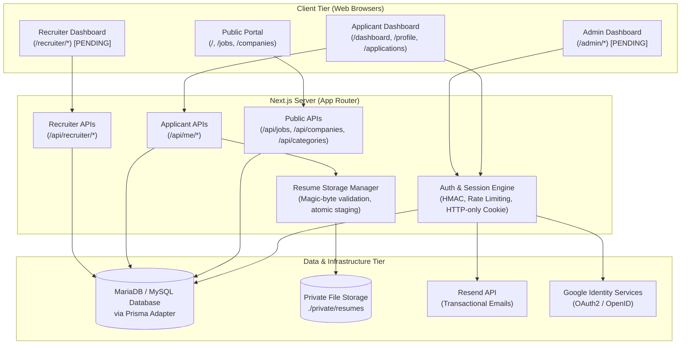

# Job Portal — Project Overview & Architecture Specification

## 1. Executive Summary & Product Purpose
The **Job Portal** is a production-grade recruitment and career management platform built with modern web technologies: Next.js (App Router), TypeScript, Prisma ORM 7, and MariaDB.

The platform is designed to serve four core user groups across distinct domains:
1. **Public Job Seekers & Visitors**: Discover jobs, browse companies, explore industries/categories, and learn about career opportunities with high SEO visibility.
2. **Applicants (Candidates)**: Maintain an industry-ready career profile (education, work experience, verified skills, and secure private resume uploads), save relevant jobs, submit job applications, and track application lifecycle statuses.
3. **Recruiters & Hiring Managers**: Manage verified company profiles, collaborate with team members, publish and manage job openings, review applicant submissions, and transition candidates through a structured hiring pipeline.
4. **Platform Administrators**: Supervise platform integrity, moderate job postings, verify corporate employer credentials, approve skill suggestions, manage system taxonomy (categories, skills), and monitor platform metrics.

---

## 2. Technology Stack Specification

| Tier | Technology | Version | Purpose & Architecture Notes |
| :--- | :--- | :--- | :--- |
| **Framework** | Next.js (App Router) | `16.4.5` (Turbopack) | Server-side rendering, API route handlers, React Server Components. |
| **Language** | TypeScript | `^5.0.0` | Strict static typing across all API routes, database schemas, and client components. |
| **UI Library** | React | `19.3.0` | Concurrent React rendering, client/server boundary segregation. |
| **Styling** | Tailwind CSS | `^4.0.0` | Utility-first CSS styling (`@tailwindcss/turbopack`). |
| **ORM** | Prisma ORM | `^7.10.1` | Type-safe query engine using custom output (`src/generated/prisma`). |
| **Database Adapter** | `@prisma/adapter-mariadb` | `^7.10.1` | Native MariaDB connection pool driver adapter. |
| **Database Engine** | MariaDB / MySQL | `>= 10.5` | Relational storage with ACID transactions and raw atomic locking. |
| **Email Service** | Resend | `^6.37.0` | Transactional OTP delivery and notification pipeline. |
| **OAuth Integration** | Google Auth Library | `^11.3.3` | Server-side ID token verification for Google OAuth 2.0 flow. |
| **Session Security** | Node.js `crypto` | Built-in | Cryptographic HMAC-SHA256 hashing, timing-safe equality, opaque hex tokens. |
| **Storage Engine** | Node.js File System | Local Disk (`./private/resumes`) | Private, unexposed filesystem storage for applicant resumes. |

---

## 3. High-Level Architecture & Domain Segregation

---

## 4. User Roles & Permission Model

The system utilizes an explicit Role-Based Access Control (RBAC) model augmented with Company-Level Membership verification:

1. **APPLICANT (`UserRole.APPLICANT`)**:
   - Default role assigned during registration.
   - Authorized to manage personal profile, education, experience, applicant skills, and private resumes.
   - Can save jobs, submit applications to internal job postings, and track personal application history.
   - Forbidden from accessing recruiter or admin API endpoints.

2. **RECRUITER (`UserRole.RECRUITER`)**:
   - Role assigned during specialized recruiter registration.
   - Associated with corporate organizations via `CompanyRecruiter` model.
   - Permissions gated by `CompanyMembershipRole` (`OWNER`, `ADMIN`, `RECRUITER`) and `CompanyMembershipStatus` (`PENDING`, `ACTIVE`, `REJECTED`, `REMOVED`).
   - Only active members can post jobs, manage company listings, and review job applicants for their affiliated company.

3. **ADMIN (`UserRole.ADMIN`)**:
   - Platform superuser.
   - Authorized to approve/reject employer company verifications, moderate jobs (`PUBLISHED`, `REJECTED`), review skill suggestions, manage categories, and audit system activity.

---

## 5. Existing Modules & Current Implementation State

| Module | Primary Path | Implementation Summary | Status |
| :--- | :--- | :--- | :--- |
| **Database Schema** | `prisma/schema.prisma` | 18 Prisma models, 8 enums, covering users, companies, jobs, applications, and applicant profile entities. | Implemented |
| **Authentication Engine** | `src/app/api/auth/*` | Email OTP (registration & login) with DB rate limits & row locks; Google OAuth with state validation; Opaque session cookies. | Implemented |
| **Applicant Profile** | `src/app/api/me/*` | Profile details, education CRUD, experience CRUD, skill associations, skill suggestions. | Implemented (API only) |
| **Resume Subsystem** | `src/lib/resume-storage.ts`, `src/app/api/me/resumes/*` | File upload, size/type validation, docx zip inspection, atomic two-phase deletion, private download endpoint. | Implemented (API only) |
| **Public Directory APIs** | `src/app/api/jobs/*`, `src/app/api/companies/*`, `src/app/api/categories/*` | Search, keyword filtering, category/company lookups, pagination, CORS handling. | Implemented (API only) |
| **Job Application Flow** | `src/app/api/jobs/[slug]/apply`, `src/app/api/me/applications` | Basic application submission with duplicate prevention and user application listing. | Partially Implemented (API only) |
| **Recruiter Management** | `src/app/api/recruiter/*` | Only 1 endpoint exists (`GET /api/recruiter/jobs/[slug]/applications`). No job creation, no company setup. | Partially Implemented (API only) |
| **Admin Operations** | None | No admin APIs, moderation workflows, or moderation routes exist. | Not Implemented |
| **Frontend UI (All Areas)** | `src/app/page.tsx`, `src/app/dashboard/page.tsx` | Default Next.js boilerplate and a single empty dashboard page with a logout button. | Missing (UI Not Established) |
